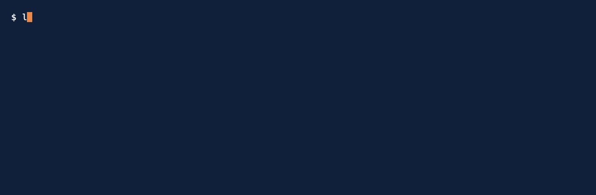
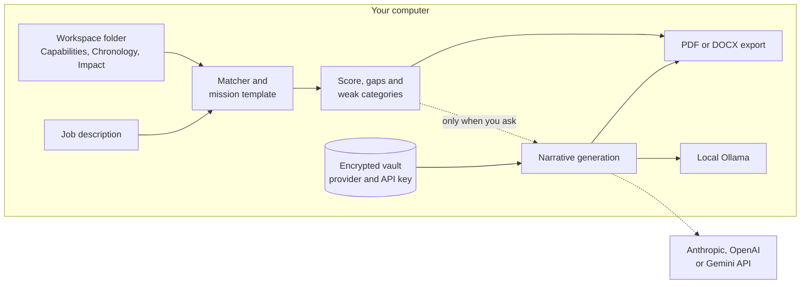

<p align="center">
  <a href="https://bearingquest.com">
    <picture>
      <source media="(prefers-color-scheme: dark)" srcset="docs/readme/bearing-quest-lockup-on-dark.svg">
      
    </picture>
  </a>
</p>

<h1 align="center">QuestVector</h1>

<p align="center">
  A local-first career-management CLI and desktop app.<br>
  Part of the <a href="https://bearingquest.com">Bearing Quest</a> project family.
</p>

<p align="center">
  <a href="https://github.com/BearingQuest/questvector/actions/workflows/tests.yml"></a>
  <a href="https://scorecard.dev/viewer/?uri=github.com/BearingQuest/questvector"></a>
  
  <a href="LICENSE"></a>
  
  <a href="CONTRIBUTING_TEMPLATES.md"></a>
</p>

> [!WARNING]
> This is a proof of concept project. Narrative generation has been tested live only with Ollama (gemma4:12b-it-q4_K_M) and Anthropic (claude-sonnet-5-5, 5 Nov 2026, synthetic data); OpenAI and Gemini are tested with mocks only. Use at your own risk.

*Command your job search with a local-only, privacy-first career flight deck. Score your career history against job descriptions, find the gaps, and own your career data.*





QuestVector is an open-source, local-first career management platform built for experienced IT professionals (5–10+ years).

## What actually exists right now

This repo describes **two** ways to run QuestVector, but only one of them has been built:

| | Python Desktop (this build) | Browser app |
|---|---|---|
| **Status** | ✅ Implemented and runs today; unit-tested with simulated AI providers; narrative generation tested live with Ollama (gemma4:12b-it-q4_K_M) and Anthropic (claude-sonnet-5-5, 5 Nov 2026, synthetic data); OpenAI and Gemini tested with mocks only | 🚧 Planned — no code exists yet ([ADR-0016](docs/decisions/0016-browser-app-static-pages.md)) |
| Stack | Pure Python core + `qv` CLI + pywebview shell | The same Python core, running in the browser through Pyodide; static files only |
| Distribution | Wheel from [GitHub Releases](https://github.com/BearingQuest/questvector/releases), or clone; `pip install` (Python 3.14) and run locally | This repository's GitHub Pages site, deployed only from the owner's release tags (see [Roadmap](#-roadmap-browser-app-not-yet-built) below) |
| Storage | Local filesystem + AES-256-GCM encrypted vault file | A folder you choose (Chrome; Edge expected but not yet tested) or the browser's own storage (Safari, Firefox) |

**If you just want to use QuestVector today, skip straight to [Quickstart](#-quickstart) below — it's all Python.** The Browser app section further down is a roadmap, not a tutorial.

**Distribution policy for this project: the only things published are release files on this repository's [GitHub Releases](https://github.com/BearingQuest/questvector/releases)** (a wheel, a source archive, and their checksums; [ADR-0014](docs/decisions/0014-github-releases.md)) **and, once built, the browser app's static files on this repository's GitHub Pages site** ([ADR-0016](docs/decisions/0016-browser-app-static-pages.md)). The Pages site is static files only: no backend, no accounts, no data collection. No custom domain, no other hosted service, no PyPI or npm-registry package, ever. The desktop build runs entirely from local files — a deliberate decision, not a temporary gap.

Both run the same Python core, so the same dossier, job description, and template give the same score in either.

---

## 🚀 Quickstart

This is the only implementation that exists — there is nothing else to install or run.

Requires **Python 3.14** (on macOS: `brew install python@3.14`).

### Install from a release

Releases are marked **pre-release** while this is a proof of concept. Download the wheel (`questvector-<version>-py3-none-any.whl`) and `SHA256SUMS` from the [Releases page](https://github.com/BearingQuest/questvector/releases), then check them in the folder you downloaded to:

```bash
shasum -a 256 -c SHA256SUMS --ignore-missing     # the wheel matches the published checksum
gh attestation verify questvector-<version>-py3-none-any.whl --repo BearingQuest/questvector
```

The second check needs the [GitHub CLI](https://cli.github.com/), signed in (`gh auth login`). It confirms the wheel was built by this repository's release workflow from a tagged commit. Releases after the move to BearingQuest are attested under `BearingQuest/questvector`; this command was verified on the v1.2.0 wheel, source archive and SBOM on 26 Nov 2026.

**v1.1.0 is different.** It was signed before the move, and its certificate names the repository that signed it (`dustenatx/QuestVector`), which can't change. Its attestations are stored under the `dustenatx` account, so it verifies only while that account exists. Use this instead, for the wheel and the same for the source archive:

```bash
gh attestation verify questvector-1.1.0-py3-none-any.whl --owner dustenatx --signer-workflow dustenatx/QuestVector/.github/workflows/release.yml
gh attestation verify questvector-1.1.0.tar.gz --owner dustenatx --signer-workflow dustenatx/QuestVector/.github/workflows/release.yml
```

Then install the wheel in its own virtual environment:

```bash
python3.14 -m venv ~/.questvector-venv
source ~/.questvector-venv/bin/activate
python -m pip install "./questvector-<version>-py3-none-any.whl[llm]"   # omit [llm] to skip all optional LLM SDKs
```

For local, offline narrative generation instead of the cloud SDKs, install [Ollama](https://ollama.com/download); see "Optional LLM narrative generation" below.

**Upgrade:** read the new version's notes in [`CHANGELOG.md`](CHANGELOG.md), download and verify the new wheel the same way, then, with the same virtual environment active, run `python -m pip install --upgrade "./questvector-<version>-py3-none-any.whl[llm]"`. Your workspace and vault live outside the virtual environment and aren't touched. A published release is never changed afterwards; fixes come as a new version.

### Install from source

```bash
git clone https://github.com/BearingQuest/questvector.git
cd questvector

python3.14 -m venv .venv
source .venv/bin/activate
python3.14 -m pip install -e ".[llm]"   # omit [llm] to skip all optional LLM SDKs
```

Update a source install with `git pull`. Developing QuestVector itself? Contributors use [uv](https://docs.astral.sh/uv/) and the committed `uv.lock` instead; see [`docs/DEVELOPMENT.md`](docs/DEVELOPMENT.md).

`[llm]` installs the SDKs for all three cloud narrative-generation providers (Anthropic, OpenAI, Gemini) at once; install `[llm-anthropic]`, `[llm-openai]`, or `[llm-gemini]` individually if you only want one. The fourth supported provider, a local Ollama server, needs no extra install here at all — see "Optional LLM narrative generation" below.

`pip install` needs one-time internet access to fetch dependencies from PyPI, the same as any Python/Node/Rust project needs its package registry at install time — after that, everything below runs fully offline (with the single explicit exception noted under "Optional LLM narrative generation").

### Run it

```bash
qv launch --dir ~/career-workspace
qv sync-ast --dir ~/career-workspace --target jd.txt --template devops-senior-mgr
qv template validate ~/career-workspace/templates/starter/devops-senior-mgr.qv-mission.yaml --fix
qv export --dir ~/career-workspace --bundle acme-resume --format pdf \
    --target jd.txt --template devops-senior-mgr
qv vault set-key --provider anthropic --dir ~/career-workspace   # store a provider + key, only if you want narrative generation

python -m questvector.desktop.app   # native HUD window (requires a display)
```

### Fill in your dossier first
`qv launch` creates three stub files in the workspace. Until you replace their contents with your own history, every match scores 0% (CRITICAL), because there is nothing to match against. Each file uses the same small Markdown format: `## ` headings, each followed by `- ` bullets. Other heading levels and blank lines are ignored.

| File | Each `##` heading is | Bullets hold |
|---|---|---|
| `Capabilities.md` | a skill domain, e.g. `## Cloud Infrastructure` | skills and tools in that domain |
| `Chronology.md` | a role, e.g. `## Senior SRE Manager — Acme Corp (Jan 2019 – Mar 2024)` | responsibilities and achievements |
| `Impact.md` | a grouping, e.g. `## Cost Reduction` | quantified results |

Matching is by keyword, so use the terms a job description would use. Common variants such as "K8s", "CI/CD" and "SOC 2" are matched to one form automatically ([ADR-0027](docs/decisions/0027-keyword-normalization.md)); singular and plural forms aren't, so "pipeline" and "pipelines" don't match each other.

Leave out statements of what you haven't done, such as "No hands-on Kubernetes" or "Terraform training only". Matching is by keyword and ignores the "no", so such a line still counts as a Kubernetes or Terraform match. `qv sync-ast` (and the desktop window) lists any line where a negation (no, not, never, without, none, or "training only") sits next to a keyword that matched, so you can remove it. The score itself is unchanged by the warning ([ADR-0030](docs/decisions/0030-negation-warnings-and-asked-keyword-counts.md)).

**Reading the score.** Next to the score, `qv sync-ast`, the desktop window and PDF and DOCX exports show "N of M template keywords in this posting are in your dossier", and each category shows "N of M asked". M counts only the posting's keywords that the template lists for that category, not everything the posting says; N is how many of those your dossier has. "Not asked" means the posting contains none of that category's keywords, and the category then counts as full coverage (it doesn't lower the score). A category with no keyword list asks about every keyword in the posting. These counts are display only: the score, the alert level and the formula are unchanged.

**Resume style.** `qv export --bundle cv --format docx --style resume` (or choose Resume in the desktop window) writes a one-column resume that screening software can read, instead of the match report ([ADR-0032](docs/decisions/0032-summary-guardrails-resume-export-file-check.md)). It needs two things:
- **Role headings with months** in `Chronology.md`, in the form `## Title — Employer (Mon YYYY – Mon YYYY)`, with `Present` for a current role: `## Senior SRE — Acme Corp (Jan 2020 – Mar 2023)`. Use the em dash after the title, a three-letter month, and an en dash or hyphen between the dates. If a heading doesn't fit, the error names it. The report style accepts any heading, so nothing breaks until you use the resume style.
- **A `Contact.md`** in the workspace, one `Key: value` per line: `Name` and `Email` are required; `Location`, `Phone`, `LinkedIn`, `GitHub`, `Website` and `Portfolio` (https URLs) are optional. It stays on your machine: it is never sent to an AI provider and never goes into a narrative prompt. Email and profile URLs become real links.

The resume has your name and contact lines, the summary (with `--narrative`, CLI only for now), your capability domain names, each role as a title line then `Employer | Mon YYYY – Mon YYYY` with up to 6 bullets, and the first Impact bullet of up to 5 groups. It never has the match score, a table or gaps. QuestVector prints what it left out. `--cutoff-years` (20 with no value, or `--cutoff-years 15`) moves roles that ended more than that many years ago to one dateless "Earlier Career" line and keeps every earlier year out of the file; it is off unless you pass it. A role that started before the cutoff but is still inside it is refused by name, because its start date can't be shown without the old year: split it into two roles or change its dates. PDF exports print their page count.

**Checking the AI summary.** `qv export --narrative` and the desktop "Generate Narrative" button check every generated summary before it is shown or exported ([ADR-0032](docs/decisions/0032-summary-guardrails-resume-export-file-check.md)). Anything that isn't the summary paragraph (a note, a second paragraph, a rule, a heading) is removed, and you are told what was removed. Sentences with a number, a capitalized name or technology term, or a word like "hands-on" or "expert" that isn't in the dossier text that was sent to the model, or with "he", "she" and similar, are listed for you to review. The check flags and never blocks: the export still runs, and the flags are never written into the file. It is a review aid, not proof the summary is accurate; read the summary before you send it. `qv export --json` prints the same result for scripts.

### About the vault
`qv vault set-key` (or the desktop Vault panel) stores your provider settings and API keys in `.questvector.vault` in the workspace, encrypted with a key derived from your passphrase ([ADR-0015](docs/decisions/0015-pbkdf2-1m-iterations-vault-v2.md)).
- **A forgotten passphrase can't be recovered.** Delete the vault file and run `qv vault set-key` again.
- **Creating a vault** needs a non-empty passphrase, and `qv vault set-key` asks for it twice. The desktop app has one field for now, so type it carefully there.
- **Passphrases and keys are read with Python's `getpass`**, so they aren't shown or saved in shell history. There is no command-line flag or environment variable for them. If you pipe input into `qv` instead of typing at a terminal, `getpass` warns that input may be echoed.
- **Upgrading from 1.1.0:** an older vault opens as before and is re-encrypted with the current settings the next time it is saved (any `qv vault set-key`). After that, QuestVector 1.1.0 can't open it.
- **Saves are crash-safe:** the vault is written to a temporary file and then swapped in, so an interrupted save leaves the previous vault intact.
- **File permissions:** on macOS and Linux the file is readable only by you. On Windows, who can read it depends on the folder's permissions; inside your user profile that is normally you and administrators.

### Tests
The test tools come with the contributor setup (uv; see [`docs/DEVELOPMENT.md`](docs/DEVELOPMENT.md)):
```bash
uv sync --all-extras
uv run pytest                                   # the whole suite; live tests skip unless turned on
uv run pytest --cov=questvector --cov-report=term-missing
```
27 of the tests exercise the cloud AI providers and need their SDKs installed (`[llm]`); without them those tests skip with the reason shown. Opt-in live tests run against a local Ollama server and against remote providers; they're skipped unless you turn them on (see `docs/DEVELOPMENT.md`). GitHub Actions runs the suite, type checks, and lint on every pull request. Three further workflows aren't required checks: a daily dependency audit, an OpenSSF Scorecard analysis, and a Claude review of each pull request ([ADR-0022](docs/decisions/0022-scheduled-audit-scorecard-and-claude-review.md)). Linting, type checks, and the full contributor workflow are in [`docs/DEVELOPMENT.md`](docs/DEVELOPMENT.md).

### Version
```bash
qv --version                                    # reads questvector.__version__ (pyproject.toml sources from it too)
```

---

## ⚙️ Configuration

QuestVector has no configuration file. Its tunables are constants in `questvector/config.py`, changed by editing the source. The installed package reads **no environment variables**; provider settings and API keys live in the [encrypted vault](#about-the-vault). The environment variables below are read only by the opt-in live tests (see [`docs/DEVELOPMENT.md`](docs/DEVELOPMENT.md)). Key variables are listed by name only, and `tests/test_readme_configuration.py` fails if this table and the code disagree.

| Name | Where | Default | What it does |
|---|---|---|---|
| `DEFAULT_CONFIG_DIR` | `config.py` | `~/.questvector` | Per-user configuration folder |
| `CAPABILITIES_FILENAME` | `config.py` | `Capabilities.md` | Dossier file for skills and tools |
| `CHRONOLOGY_FILENAME` | `config.py` | `Chronology.md` | Dossier file for roles |
| `IMPACT_FILENAME` | `config.py` | `Impact.md` | Dossier file for quantified results |
| `CONTACT_FILENAME` | `config.py` | `Contact.md` | Optional contact details for the resume style; never sent to an AI provider |
| `DOSSIER_FILENAMES` | `config.py` | `Capabilities.md, Chronology.md, Impact.md` | The three dossier files a workspace expects |
| `TEMPLATES_DIRNAME` | `config.py` | `templates` | Workspace folder for mission templates |
| `STARTER_TEMPLATES_DIRNAME` | `config.py` | `starter` | Subfolder for the bundled starter templates |
| `COMMUNITY_TEMPLATES_DIRNAME` | `config.py` | `community` | Subfolder for community templates |
| `BUNDLES_DIRNAME` | `config.py` | `bundles` | Workspace folder for bundles |
| `LOCK_FILENAME` | `config.py` | `.questvector.lock` | Workspace lock file |
| `VAULT_FILENAME` | `config.py` | `.questvector.vault` | Encrypted vault file |
| `WEIGHT_SUM_TARGET` | `config.py` | `1.0` | A template's category weights must add up to this |
| `WEIGHT_SUM_TOLERANCE` | `config.py` | `0.005` | Allowed distance from the target before a template is flagged |
| `MATCH_RED_FLAG_WEIGHT_THRESHOLD` | `config.py` | `0.2` | A zero-coverage category at or above this weight is a critical red flag |
| `MATCH_CRITICAL_SCORE` | `config.py` | `40.0` | G-Force score below this is Critical |
| `MATCH_WARNING_SCORE` | `config.py` | `70.0` | G-Force score below this is a Warning |
| `STOPWORDS` | `config.py` | `55 words` | Words the matcher ignores |
| `THEME.background` | `config.py` | `#0b0f19` | Current HUD colour, replaced by the UI redesign |
| `THEME.panel` | `config.py` | `#0d1322` | Current HUD colour, replaced by the UI redesign |
| `THEME.accent` | `config.py` | `#00f2fe` | Current HUD colour, replaced by the UI redesign |
| `THEME.success` | `config.py` | `#10b981` | Current HUD colour, replaced by the UI redesign |
| `THEME.warning` | `config.py` | `#f59e0b` | Current HUD colour, replaced by the UI redesign |
| `THEME.critical` | `config.py` | `#ef4444` | Current HUD colour, replaced by the UI redesign |
| `QV_LIVE_PROVIDERS` | environment | `unset` | Comma-separated remote providers the live test runs against |
| `QV_ANTHROPIC_MODEL` | environment | `claude-sonnet-5-5` | Model for the live Anthropic test |
| `QV_OPENAI_MODEL` | environment | `gpt-6-luna` | Model for the live OpenAI test |
| `QV_GEMINI_MODEL` | environment | `gemini-3.6-flash` | Model for the live Gemini test |
| `ANTHROPIC_API_KEY` | environment | `unset` | Key for the live Anthropic test (secret, never printed) |
| `OPENAI_API_KEY` | environment | `unset` | Key for the live OpenAI test (secret, never printed) |
| `GEMINI_API_KEY` | environment | `unset` | Key for the live Gemini test (secret, never printed) |
| `QV_OLLAMA_LIVE` | environment | `unset` | Set to `1` to run the live Ollama test |
| `QV_OLLAMA_MODEL` | environment | `gemma4:12b-it-q4_K_M` | Model for the live Ollama test |
| `QV_OLLAMA_HOST` | environment | `http://localhost:11434` | Ollama server URL |
| `QV_OLLAMA_TIMEOUT` | environment | `300.0` | Seconds to wait for Ollama |

---

## 🧭 Features (Python build — this is what exists)

* **`qv` CLI** (stdlib `argparse`) — `launch`, `sync-ast`, `export`, `template validate`, `vault set-key`.
* **AST Block Matching:** Deconstruct target Job Descriptions and map them against your career chronology and capabilities.
* **Community Mission Templates:** Pre-built matching profiles for Senior DevOps, Cybersecurity, Platform Engineering, IT Project Management, and more (7 starter templates included).
* **Native desktop app** (pywebview) themed to the Tactical Ops Flight Deck HUD, including a live G-Force gauge.
* **PDF/DOCX export** of the dossier and match summary (reportlab / python-docx).
* **Encrypted local vault** (AES-256-GCM, key derived from your passphrase with PBKDF2-HMAC-SHA256 at 1,000,000 iterations) for provider settings and API keys. See [About the vault](#about-the-vault).
* **Local-first storage:** Your dossier and career data live on disk, not in a vendor's database.
* **Optional LLM narrative generation, four provider choices** — an explicit, user-triggered action (`qv export --narrative`, or the desktop UI's "Generate Narrative" button) that drafts a tailored resume summary. Pick one provider via `qv vault set-key --provider <name>`:

  | Provider | Runs | Needs an API key? | Get a key |
  |---|---|---|---|
  | `anthropic` (Claude) | Remote | Yes | [console.anthropic.com](https://console.anthropic.com/settings/keys) |
  | `openai` | Remote | Yes | [platform.openai.com](https://platform.openai.com/api-keys) — **note:** this is the OpenAI Platform, the API behind ChatGPT, not a ChatGPT Plus login; they're separate accounts and separate billing. |
  | `gemini` (Google) | Remote | Yes | [aistudio.google.com](https://aistudio.google.com/apikey) |
  | `ollama` | **Local** | No | [ollama.com](https://ollama.com/download) — install it, run it, `ollama pull <model>` |

  The three remote providers are the *only* code paths in this build that make an outbound network call, and each is off unless you configure it and explicitly ask for narrative generation; connecting a remote provider requires your own account/subscription with that provider (with data-sharing/training disabled if you want to preserve zero-tracking) and is subject to that provider's usage fees. `ollama` is the exception: once it's installed and running, narrative generation through it never leaves your machine. The CLI and desktop UI print each provider's setup link and this same OpenAI/ChatGPT clarification at the moment you configure it, so you're not left guessing where to go.

  **Extensible by design:** the four providers above live in one data-driven registry (`questvector/core/llm.py`'s `PROVIDERS`), each entry pairing its metadata with a small factory function. The CLI's `--provider` choices and the desktop UI's provider dropdown both read that registry directly, so a fifth provider (remote or local) is three additions to that one file — a generator class, a factory function, and a registry entry — with no changes needed anywhere else. See that module's docstring for the exact steps.

---

## 🗺️ Roadmap: Browser app (not yet built)

Nothing in this section exists as code today. It replaces the earlier plan for a React/Rust "Web Cockpit", which won't be built ([ADR-0016](docs/decisions/0016-browser-app-static-pages.md)).

**What's planned:** a version of QuestVector for people who can't install software. It runs the same Python core in the browser through [Pyodide](https://pyodide.org):

- **Static files only.** It's served from this repository's GitHub Pages site, with no backend, no accounts, no data collection, and no third-party scripts.
- **Your data stays in your browser.** It can work in a folder you choose (Chrome; Edge expected but not yet tested); in Safari and Firefox your files stay in the browser's own storage, and you download backups.
- **No AI at first.** The first version has no AI narrative.

A spike on 28 Oct 2026 showed the core running unchanged in Chrome, Safari and Firefox ([findings](docs/spikes/2026-10-browser-pyodide.md)). The work is planned in [backlog item 16](docs/BACKLOG.md#16-browser-only-app), and the requirements are in [PRD §5.9](docs/PRD.md#59-browser-app). The site's address will be added here once it's live.

Do not trust any `questvector.dev` URL, `npx questvector`, or `npm install questvector` command as real; none of them exist, and none ever will — see the distribution policy above.

---

## 📄 Documentation
| Document | What it covers |
|---|---|
| [`docs/PRD.md`](docs/PRD.md) | Product requirements: goals, non-goals, and each requirement marked built or planned |
| `docs/QuestVector_Spec.pdf` | System specification for the Python build as it exists today: architecture, CLI reference, template schema, matching engine, LLM subsystem |
| [`docs/decisions/`](docs/decisions/) | Decisions log: why the project is built the way it is |
| [`CHANGELOG.md`](CHANGELOG.md) | What changed in each version |
| [`docs/BACKLOG.md`](docs/BACKLOG.md) | Planned work |
| [`docs/DEVELOPMENT.md`](docs/DEVELOPMENT.md) | Developer setup, checks, and how to submit a change |
| [`CONTRIBUTING_TEMPLATES.md`](CONTRIBUTING_TEMPLATES.md) | How to write and submit a mission template |
| `docs/QuestVector - The AI Capability Ladder.mp4` | Video overview of the project |

---

## 🤝 Contributing
Interested in building or submitting custom `.qv-mission.yaml` templates? Check out our [Community Template Contribution Guide](CONTRIBUTING_TEMPLATES.md). Contributed templates go in `templates/community/`, starting from `templates/boilerplate.qv-mission.yaml`. The seven built-in starters ship inside the package (`questvector/data/starter_templates/`), and `qv launch` copies them into each workspace's `templates/starter/` folder. A GitHub Actions check validates every template under `templates/` on each pull request. The schema in that guide and the one `questvector/core/templates.py` validates against have been reconciled into one — see that module's docstring for the full merge notes.

License: [MIT](LICENSE)
